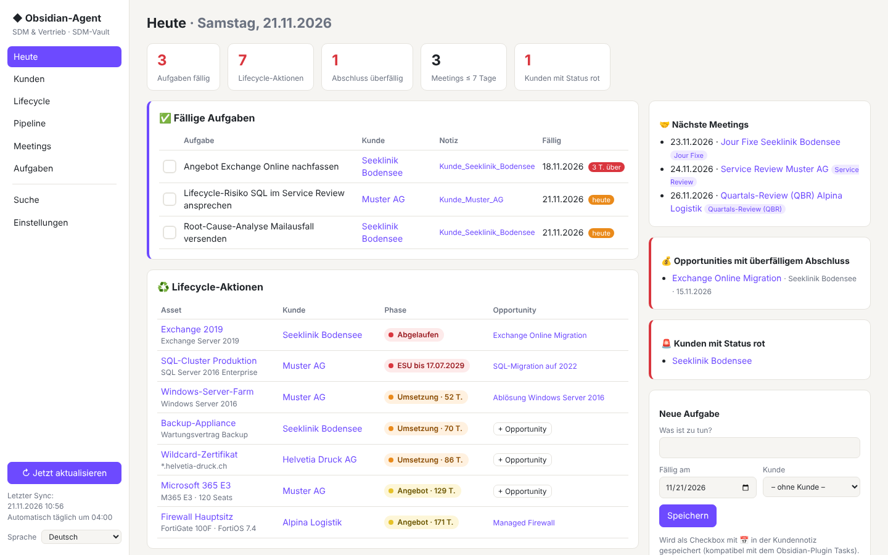
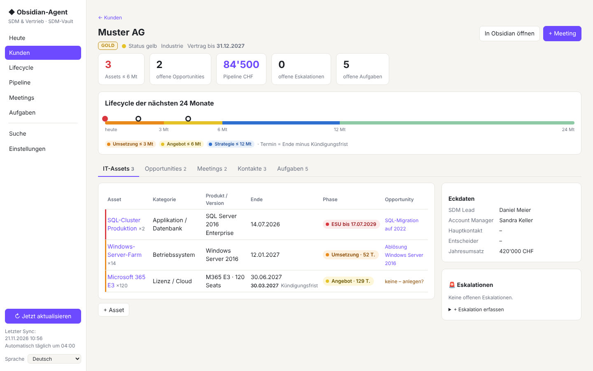
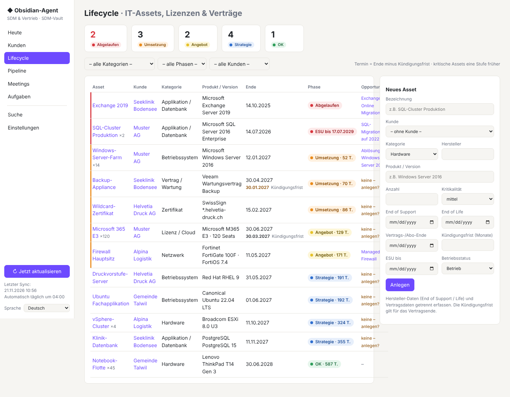
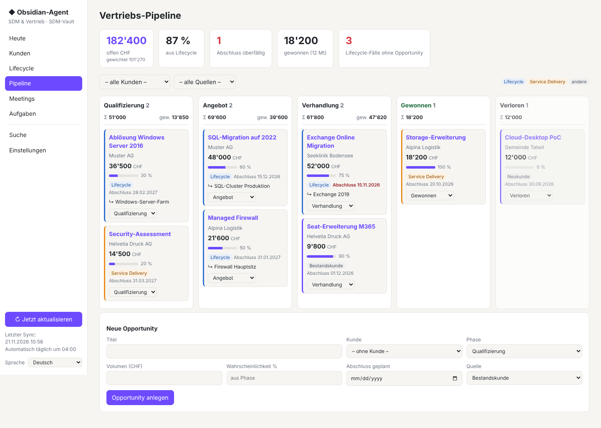
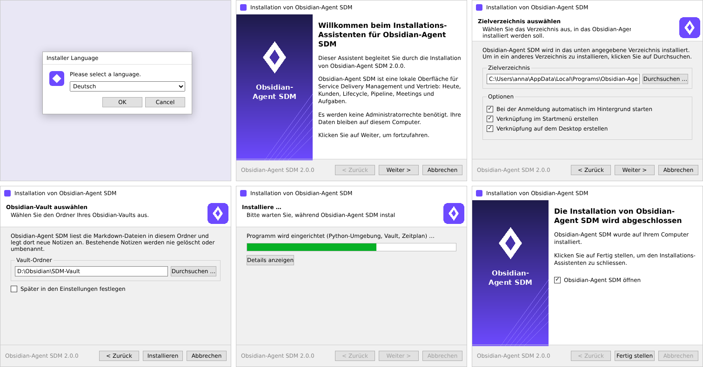

# ◆ Obsidian-Agent SDM

🇩🇪 **Deutsch** · 🇬🇧 [English](../readme_en.md) · 🇪🇸 [Español](../readme_es.md)

### Dein Obsidian-Vault wird zum Cockpit für Service Delivery und Vertrieb: Kunden, Lifecycle, Pipeline, Meetings und Aufgaben auf einen Blick.

**Lokal. Ohne Cloud. Ohne Lock-in. Alles bleibt reines Markdown.**

`Windows` `macOS` `Linux` `Python 3.10+` `6 Sprachen` `http://127.0.0.1:5055`

**[⬇️ Download](#download) · [📚 Dokumentation](docs/README.md) · [⚡ Kurzanleitung](docs/README.md#kurzanleitung)**

---

## Das Problem

Der SQL Server beim Kunden ist seit Monaten aus dem Support. Die Firewall-Subscription läuft im Frühling ab. Die Kündigungsfrist für die Microsoft-365-Lizenzen endet nächste Woche. Und das Angebot, das daraus hätte entstehen sollen, gibt es noch nicht.

Die Informationen sind da, aber verstreut: im Ticketsystem, in Excel-Listen, in Meeting-Notizen und im Kopf des Service Delivery Managers.

> Welche Systeme laufen bei meinen Kunden in den nächsten zwölf Monaten aus?
> Wo verpasse ich gerade eine Kündigungsfrist?
> Welche Lifecycle-Themen haben noch keine Opportunity?
> Was muss ich morgen im Service Review ansprechen?

Obsidian ist ideal, um dieses Wissen festzuhalten. Mit Dataview-Abfragen, Vorlagen und Plugins lässt sich viel bauen. Aber jede Ansicht musst du selbst programmieren und pflegen, und Fristen rechnet dir niemand aus.

## Die Lösung

Der **Obsidian-Agent SDM** liest deinen Vault und macht daraus eine Arbeitsoberfläche für Service Delivery Management und Vertrieb. Er rechnet aus, wann du handeln musst, und zeigt dir, wo aus dem Betrieb ein Geschäft wird.

| | |
|---|---|
| 🎯 **Ein Cockpit für den Tag.** Fällige Aufgaben, Lifecycle-Aktionen, überfällige Abschlüsse und die nächsten Meetings auf einer Seite. | ♻️ **Lifecycle mit System.** Die Phasen Strategie, Angebot und Umsetzung entstehen automatisch aus End of Support, End of Life und Kündigungsfrist. |
| 💰 **Vom Betrieb zum Upselling.** Aus jedem auslaufenden Asset wird mit einem Klick eine verknüpfte Opportunity. | 🏢 **Kunden auf einen Blick.** SLA, Status, Pipeline, Kontakte, Eskalationen und ein Lifecycle-Zeitstrahl über 24 Monate. |
| 📝 **Markdown bleibt die Wahrheit.** Jede Änderung landet als normale Notiz im Vault. Du kannst jederzeit direkt in Obsidian weiterarbeiten. | 🌍 **Sechs Sprachen.** Deutsch, Englisch, Französisch, Italienisch, Spanisch und Rumänisch, umschaltbar mit einem Klick. |

---

## Funktionen

### 🎯 Heute
Dein Start in den Tag: fällige und überfällige Aufgaben, Lifecycle-Fälle der nächsten sechs Monate (mit Hinweis, wo noch keine Opportunity existiert), Opportunities mit überfälligem Abschluss, die Meetings der nächsten Tage und Kunden mit Status rot. Der Agent schreibt dieselbe Übersicht jeden Morgen zusätzlich als `Heute.md` in deinen Vault.

### 🏢 Kunden und Kunden-Steckbrief
Alle Kunden als Kacheln mit SLA-Stufe, Ampelstatus, Vertragsende, nächstem Lifecycle-Fall und offener Pipeline. Ein Klick öffnet den Steckbrief: Kennzahlen, Lifecycle-Zeitstrahl über 24 Monate und Register für IT-Assets, Opportunities, Meetings, Kontakte und Aufgaben. Eskalationen erfasst du direkt in der Seitenleiste.

### ♻️ Lifecycle
Hardware, Betriebssysteme, Datenbanken, Lizenzen, Verträge und Zertifikate in einer Liste, sortiert nach Dringlichkeit. Massgeblich ist der **Handlungstermin**: das frühere Datum aus End of Support bzw. End of Life und aus Vertragsende minus Kündigungsfrist.

| Phase | Handlungstermin in | Was jetzt zu tun ist |
|---|---|---|
| 🔵 Strategie | ≤ 12 Monaten | im Service Review ansprechen, Budget anstossen |
| 🟡 Angebot | ≤ 6 Monaten | Konzept mit Delivery, Angebot erstellen |
| 🟠 Umsetzung | ≤ 3 Monaten | bestellen, Fristen wahren, Migration planen |
| 🔴 Frist verpasst / Abgelaufen | überschritten | sofort klären, ESU-Laufzeit wird angezeigt |

Geschäftskritische Assets rücken automatisch eine Stufe früher.

### 💰 Vertriebs-Pipeline
Kanban-Board von der Qualifizierung bis zum Abschluss, mit Summe und gewichtetem Volumen pro Phase. Du siehst, welcher Anteil der Pipeline aus dem Lifecycle stammt und wie viele Lifecycle-Fälle noch keine Opportunity haben. Die Phase änderst du direkt auf der Karte, der Agent schreibt sie in die Notiz zurück.

### 🤝 Meetings
Jour Fixe, Service Review, Quartals-Review, Call oder Workshop: Ein neues Protokoll enthält automatisch die Lifecycle-Themen der nächsten zwölf Monate und alle offenen Aufgaben des Kunden. Die Vorbereitung ist damit in Sekunden erledigt.

### ✅ Aufgaben
Aufgaben sind normale Checkbox-Zeilen in deinen Notizen, kompatibel mit dem Obsidian-Plugin **Tasks**: `- [ ] Angebot senden 📅 2026-12-01`. Der Agent sammelt sie aus dem ganzen Vault, gruppiert sie nach Fälligkeit und lässt dich direkt abhaken.

### Und ausserdem
- 🔎 **Volltextsuche** über den ganzen Vault
- 📄 **Obsidian-Vorlagen** für Kunde, Kontakt, Asset, Opportunity, Meeting und Eskalation, in jeder Sprache
- 🌙 **Dark Mode** automatisch nach Systemeinstellung
- 🔄 **Täglicher Sync** um 04:00, verpasste Läufe werden nachgeholt
- 🧩 **Rückwärtskompatibel**: Alte Notizen mit `typ: lcm`, YAML-Kommentaren oder Kundennamen statt Links werden erkannt
- 👥 **Teamfähig**: Die Eigenschaften sind in allen Sprachen gleich, gemischte Teams nutzen denselben Vault

---

## Warum nicht einfach Dataview und Co.?

| | Obsidian + Plugins | Obsidian-Agent SDM |
|---|:---:|:---:|
| Notizen in Markdown, ohne Lock-in | ✅ | ✅ |
| Tabellen und Abfragen über Eigenschaften | ✅ | ✅ |
| Lifecycle-Phasen inkl. Kündigungsfrist automatisch berechnet | – | ✅ |
| Opportunity aus einem Asset mit einem Klick | – | ✅ |
| Pipeline mit gewichtetem Volumen | – | ✅ |
| Meeting-Protokoll mit Lifecycle-Themen und offenen Aufgaben vorbefüllt | – | ✅ |
| Fertige Oberfläche ohne eigene Abfragen | – | ✅ |
| Tägliche Übersicht im Vault, auch ohne offenes Obsidian | – | ✅ |
| Sechs Sprachen inkl. Vorlagen | – | ✅ |

Der Agent ersetzt Obsidian nicht. Er ergänzt es: Du schreibst weiter in Obsidian, der Agent rechnet und zeigt.

---

## ⬇️ In 5 Minuten startklar

| Download | Für |
|---|---|
| **[ObsidianAgent-SDM-Setup-Windows.zip](../ObsidianAgent-SDM-Setup-Windows.zip)** | Windows 10/11 mit Setup-Assistent |
| **[ObsidianAgent-SDM-Mac.zip](../ObsidianAgent-SDM-Mac.zip)** | macOS 11+ (Installationspaket) |
| [ObsidianAgent-SDM.zip](../ObsidianAgent-SDM.zip) | ohne Setup, auch Linux |

**Windows**
1. [Python](https://www.python.org/downloads/windows/) installieren und «Add python.exe to PATH» anhaken.
2. ZIP entpacken und `ObsidianAgent-SDM-Setup.exe` starten.
3. Im Assistenten Sprache, Zielordner mit Optionen (Autostart, Startmenü, Desktop) und deinen Obsidian-Vault wählen. Fertig.

**macOS**
1. [Python](https://www.python.org/downloads/macos/) installieren oder `brew install python` ausführen.
2. ZIP entpacken und `ObsidianAgent-SDM.pkg` mit Rechtsklick → Öffnen starten.
3. Im Terminal-Fenster den Vault auswählen. Fertig.

**➜ Danach im Browser öffnen: [http://127.0.0.1:5055](http://127.0.0.1:5055)**

Kurzanleitung mit allen Schritten: [Dokumentation](docs/README.md) · ausführlich: [Anleitung_de.md](docs/Anleitung_de.md)

---

## Sicher und ohne Risiko

- 🔒 **Deine Daten bleiben bei dir.** Der Agent läuft nur auf deinem Computer, nichts wird in eine Cloud übertragen.
- 📝 **Dein Vault gehört dir.** Alles ist Markdown. Die Datenbank ist nur ein Index und wird bei jedem Sync neu aufgebaut.
- 🧹 **Saubere Deinstallation.** Autostart und Zeitplan werden entfernt, Einstellungen auf den Desktop gesichert. Der Vault wird nie verändert.
- 🚚 **Einfacher Umzug.** Neu installieren, `config.json` zurückkopieren, weiterarbeiten.
- 👤 **Keine Administratorrechte nötig.** Die Installation läuft im Benutzerkonto.
- 🛡️ **Datenschutz mitgedacht.** Kontakte erhalten ein Löschdatum, die Vorlagen weisen auf sachliche, geschäftliche Notizen hin.

---

## 📚 Dokumentation in sechs Sprachen

| Sprache | Anleitung |
|---|---|
| 🇩🇪 Deutsch (Master) | [Anleitung_de.md](docs/Anleitung_de.md) |
| 🇬🇧 English | [Guide_en.md](docs/Guide_en.md) |
| 🇫🇷 Français | [Guide_fr.md](docs/Guide_fr.md) |
| 🇮🇹 Italiano | [Guida_it.md](docs/Guida_it.md) |
| 🇪🇸 Español | [Guia_es.md](docs/Guia_es.md) |
| 🇷🇴 Română | [Ghid_ro.md](docs/Ghid_ro.md) |

---

**Weniger suchen. Keine Frist verpassen. Mehr verkaufen.**

*Obsidian-Agent SDM: Service Delivery und Vertrieb in einem Cockpit.*

Alle Screenshots zeigen fiktive Beispieldaten.
