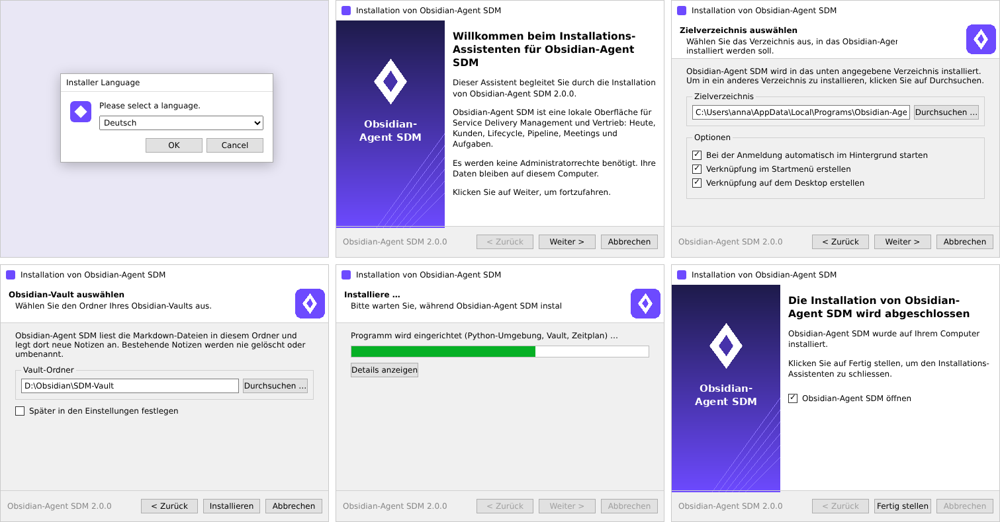

# ◆ Obsidian-Agent SDM – Dokumentation

Lokale Weboberfläche für Service Delivery Management und Vertrieb auf Basis eines Obsidian-Vaults.
*Local web interface for service delivery management and sales, based on an Obsidian vault.*

## 📚 Anleitungen · Guides

| Sprache · Language | Anleitung · Guide |
|---|---|
| 🇩🇪 Deutsch (Master) | [Anleitung_de.md](Anleitung_de.md) |
| 🇬🇧 English | [Guide_en.md](Guide_en.md) |
| 🇫🇷 Français | [Guide_fr.md](Guide_fr.md) |
| 🇮🇹 Italiano | [Guida_it.md](Guida_it.md) |
| 🇪🇸 Español | [Guia_es.md](Guia_es.md) |
| 🇷🇴 Română | [Ghid_ro.md](Ghid_ro.md) |

## ⬇️ Downloads

| Datei · File | Für · For |
|---|---|
| [ObsidianAgent-SDM-Setup-Windows.zip](../../ObsidianAgent-SDM-Setup-Windows.zip) | Windows 10/11, Setup-Assistent · setup wizard |
| [ObsidianAgent-SDM-Mac.zip](../../ObsidianAgent-SDM-Mac.zip) | macOS 11+, Installationspaket · installer package (.pkg) |
| [ObsidianAgent-SDM.zip](../../ObsidianAgent-SDM.zip) | Ohne Setup, auch Linux · without setup, also Linux |
| [obsidian-agent-2.0.0-quellcode.zip](../../obsidian-agent-2.0.0-quellcode.zip) | Quellcode · source code |

**Voraussetzung · Requirement:** Python 3.10+ (Windows) bzw. 3.9+ (macOS) und Internet beim ersten Start · and internet on first start.

---

## ⚡ Kurzanleitung Installation (Windows)

1. **Python installieren:** [python.org](https://www.python.org/downloads/windows/) und **«Add python.exe to PATH»** anhaken.
2. **Setup starten:** `ObsidianAgent-SDM-Setup-Windows.zip` entpacken und `ObsidianAgent-SDM-Setup.exe` doppelklicken. Bei *«Der Computer wurde durch Windows geschützt»*: **Weitere Informationen → Trotzdem ausführen**.
3. **Sprache wählen:** Deutsch, English, Français, Italiano, Español oder Română.
4. **Willkommen:** Mit **Weiter** beginnen. Administratorrechte sind nicht nötig.
5. **Zielverzeichnis und Optionen:** Ordner übernehmen und festlegen, ob der Agent bei der Anmeldung automatisch startet und ob Verknüpfungen im Startmenü und auf dem Desktop entstehen.
6. **Obsidian-Vault:** Den Ordner deines Vaults wählen oder «Später in den Einstellungen festlegen» anhaken, dann **Installieren**.
7. **Installation:** Das Setup richtet Python-Umgebung, Vault und den täglichen Sync ein, ohne Konsolenfenster.
8. **Fertig stellen:** Mit «Obsidian-Agent SDM öffnen» startet die Oberfläche unter **http://127.0.0.1:5055**.

**macOS:** `ObsidianAgent-SDM-Mac.zip` entpacken, `ObsidianAgent-SDM.pkg` mit Rechtsklick → Öffnen starten und im Terminal-Fenster den Vault wählen.

Ausführlich: [Anleitung_de.md](Anleitung_de.md)

---

🇬🇧 <b>Quick installation (Windows)</b>

1. Install [Python](https://www.python.org/downloads/windows/) and tick **«Add python.exe to PATH»**.
2. Unzip `ObsidianAgent-SDM-Setup-Windows.zip` and run `ObsidianAgent-SDM-Setup.exe`. If *«Windows protected your PC»* appears: **More info → Run anyway**.
3. Choose the language, then click **Next** on the welcome page.
4. **Install location and options:** keep the folder and choose autostart at sign-in, Start menu and desktop shortcuts.
5. **Obsidian vault:** choose your vault folder or tick «Set it later in the settings», then **Install**.
6. **Finish:** «Open Obsidian-Agent SDM» opens **http://127.0.0.1:5055**.

**macOS:** unzip `ObsidianAgent-SDM-Mac.zip`, open `ObsidianAgent-SDM.pkg` with right-click → Open and choose the vault in the Terminal window. Full guide: [Guide_en.md](Guide_en.md)

🇫🇷 <b>Installation rapide (Windows)</b>

1. Installer [Python](https://www.python.org/downloads/windows/) en cochant **«Add python.exe to PATH»**.
2. Décompresser `ObsidianAgent-SDM-Setup-Windows.zip` et lancer `ObsidianAgent-SDM-Setup.exe`. Si *«Windows a protégé votre ordinateur»* s'affiche : **Informations complémentaires → Exécuter quand même**.
3. Choisir la langue, puis cliquer sur **Suivant** sur la page d'accueil.
4. **Dossier d'installation et options :** conserver le dossier, choisir le démarrage automatique et les raccourcis (menu Démarrer, bureau).
5. **Coffre Obsidian :** choisir le dossier du coffre ou cocher «Définir plus tard dans les paramètres», puis **Installer**.
6. **Terminer :** «Ouvrir Obsidian-Agent SDM» ouvre **http://127.0.0.1:5055**.

**macOS :** décompresser `ObsidianAgent-SDM-Mac.zip`, ouvrir `ObsidianAgent-SDM.pkg` par clic droit → Ouvrir et choisir le coffre dans le Terminal. Guide complet : [Guide_fr.md](Guide_fr.md)

🇮🇹 <b>Installazione rapida (Windows)</b>

1. Installare [Python](https://www.python.org/downloads/windows/) spuntando **«Add python.exe to PATH»**.
2. Decomprimere `ObsidianAgent-SDM-Setup-Windows.zip` e avviare `ObsidianAgent-SDM-Setup.exe`. Se compare *«PC protetto da Windows»*: **Ulteriori informazioni → Esegui comunque**.
3. Scegliere la lingua, poi fare clic su **Avanti** nella pagina di benvenuto.
4. **Cartella di installazione e opzioni:** mantenere la cartella e scegliere avvio automatico e collegamenti (menu Start, desktop).
5. **Vault Obsidian:** scegliere la cartella del vault o spuntare «Impostare più tardi nelle impostazioni», poi **Installa**.
6. **Fine:** «Apri Obsidian-Agent SDM» apre **http://127.0.0.1:5055**.

**macOS:** decomprimere `ObsidianAgent-SDM-Mac.zip`, aprire `ObsidianAgent-SDM.pkg` con clic destro → Apri e scegliere il vault nel Terminale. Guida completa: [Guida_it.md](Guida_it.md)

🇪🇸 <b>Instalación rápida (Windows)</b>

1. Instale [Python](https://www.python.org/downloads/windows/) y marque **«Add python.exe to PATH»**.
2. Descomprima `ObsidianAgent-SDM-Setup-Windows.zip` y ejecute `ObsidianAgent-SDM-Setup.exe`. Si aparece *«Windows protegió su PC»*: **Más información → Ejecutar de todas formas**.
3. Elija el idioma y pulse **Siguiente** en la página de bienvenida.
4. **Carpeta de instalación y opciones:** mantenga la carpeta y elija el inicio automático y los accesos directos (menú Inicio, escritorio).
5. **Bóveda de Obsidian:** elija la carpeta de la bóveda o marque «Configurarla más tarde en los ajustes» y pulse **Instalar**.
6. **Finalizar:** «Abrir Obsidian-Agent SDM» abre **http://127.0.0.1:5055**.

**macOS:** descomprima `ObsidianAgent-SDM-Mac.zip`, abra `ObsidianAgent-SDM.pkg` con clic derecho → Abrir y elija la bóveda en la ventana de Terminal. Guía completa: [Guia_es.md](Guia_es.md)

🇷🇴 <b>Instalare rapidă (Windows)</b>

1. Instalați [Python](https://www.python.org/downloads/windows/) și bifați **«Add python.exe to PATH»**.
2. Dezarhivați `ObsidianAgent-SDM-Setup-Windows.zip` și porniți `ObsidianAgent-SDM-Setup.exe`. Dacă apare *«Windows a protejat PC-ul»*: **Mai multe informații → Executare oricum**.
3. Alegeți limba, apoi apăsați **Înainte** pe pagina de bun venit.
4. **Folder de instalare și opțiuni:** păstrați folderul și alegeți pornirea automată și scurtăturile (meniul Start, desktop).
5. **Seiful Obsidian:** alegeți folderul seifului sau bifați «Setați mai târziu în setări», apoi **Instalare**.
6. **Finalizare:** «Deschide Obsidian-Agent SDM» deschide **http://127.0.0.1:5055**.

**macOS:** dezarhivați `ObsidianAgent-SDM-Mac.zip`, deschideți `ObsidianAgent-SDM.pkg` cu clic dreapta → Deschide și alegeți seiful în fereastra Terminal. Ghid complet: [Ghid_ro.md](Ghid_ro.md)

---

Screenshots mit fiktiven Beispieldaten · Screenshots with fictional sample data.
