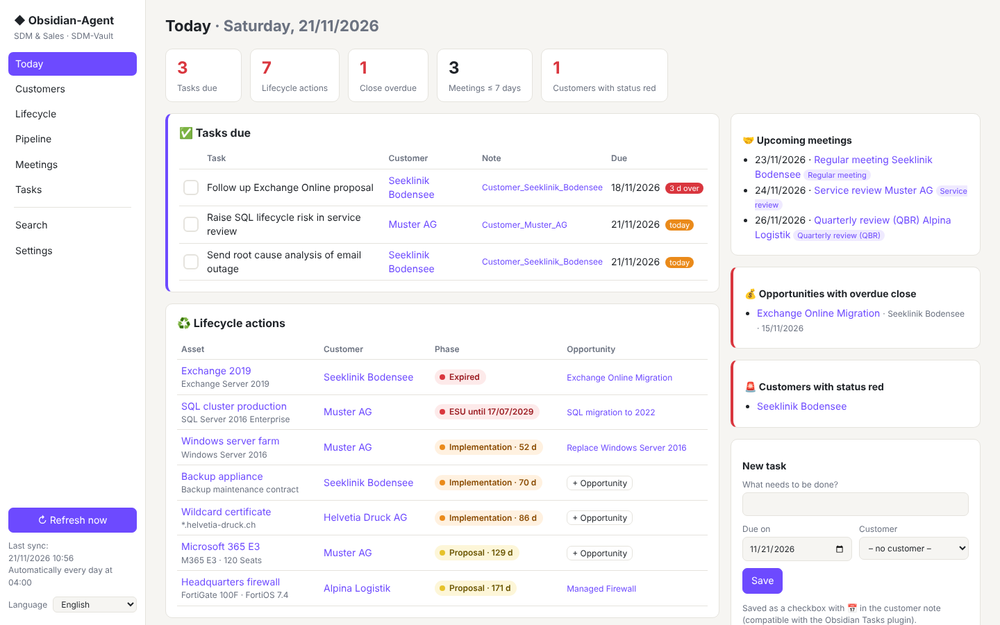
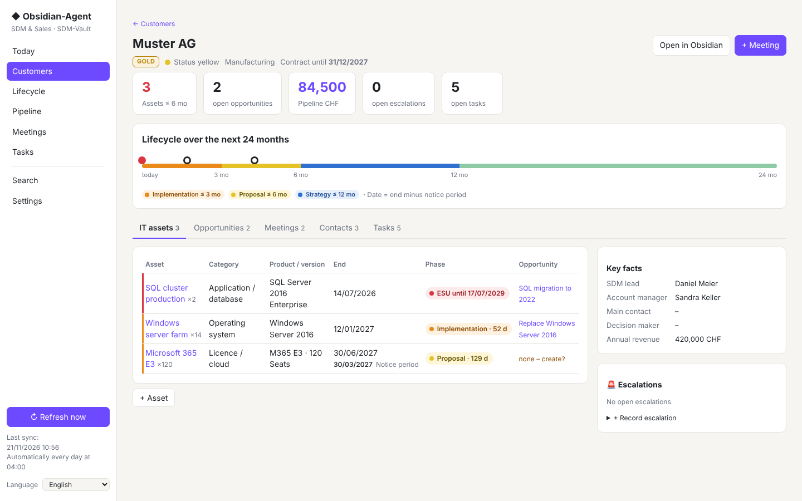
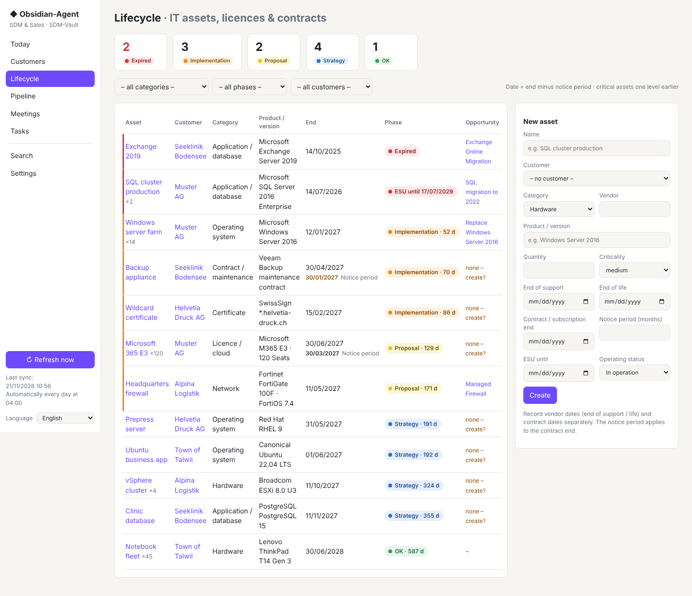
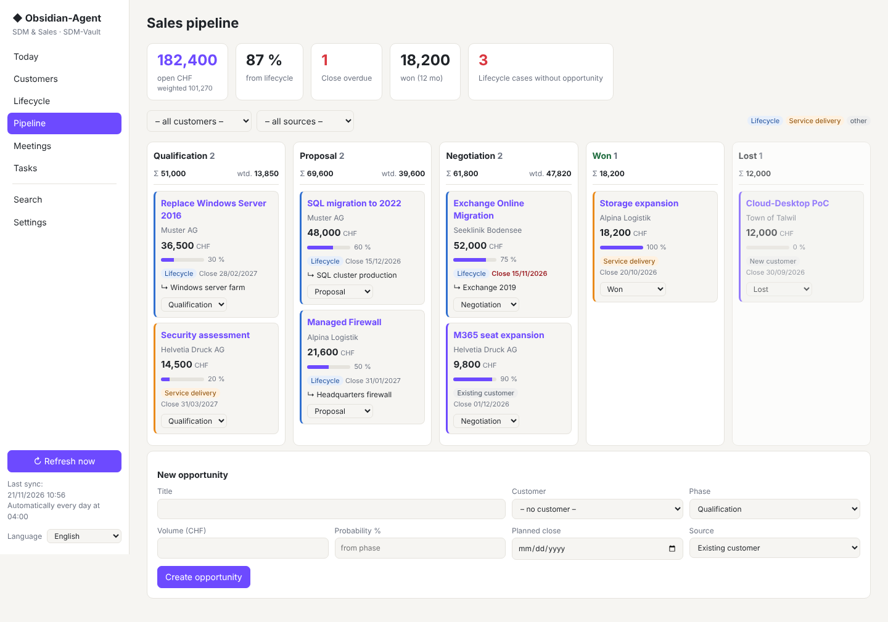
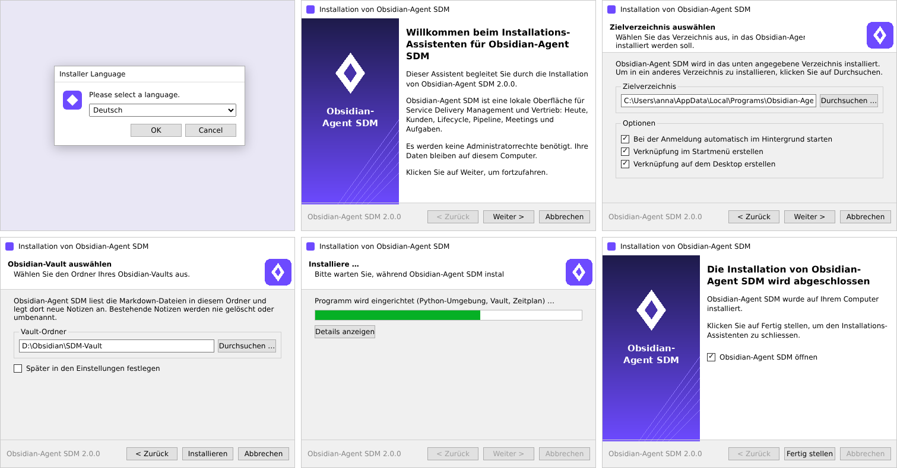

# ◆ Obsidian-Agent SDM

🇩🇪 [Deutsch](README.md) · 🇬🇧 **English** · 🇪🇸 [Español](readme_es.md)

### Turn your Obsidian vault into a cockpit for service delivery and sales: customers, lifecycle, pipeline, meetings and tasks at a glance.

**Local. No cloud. No lock-in. Everything stays plain Markdown.**

`Windows` `macOS` `Linux` `Python 3.10+` `6 languages` `http://127.0.0.1:5055`

**[⬇️ Download](#download) · [📚 Documentation](obsidian-agent-readme/docs/README.md) · [⚡ Quick installation](obsidian-agent-readme/docs/README.md#quick-installation)**

---

## The problem

The customer's SQL Server has been out of support for months. The firewall subscription expires in spring. The notice period for the Microsoft 365 licences ends next week. And the proposal that should have come out of all this does not exist yet.

The information is there, but scattered: in the ticket system, in Excel sheets, in meeting notes and in the service delivery manager's head.

> Which systems at my customers reach end of life in the next twelve months?
> Where am I about to miss a notice period?
> Which lifecycle topics have no opportunity yet?
> What do I need to raise in tomorrow's service review?

Obsidian is ideal for capturing this knowledge. With Dataview queries, templates and plugins you can build a lot. But you have to program and maintain every view yourself, and nobody calculates your deadlines for you.

## The solution

**Obsidian-Agent SDM** reads your vault and turns it into a workspace for service delivery management and sales. It calculates when you need to act and shows you where operations turn into business.

| | |
|---|---|
| 🎯 **One cockpit for your day.** Tasks due, lifecycle actions, overdue closes and upcoming meetings on a single page. | ♻️ **Lifecycle with a system.** The strategy, proposal and implementation phases are derived automatically from end of support, end of life and notice period. |
| 💰 **From operations to upselling.** Every expiring asset becomes a linked opportunity with one click. | 🏢 **Customers at a glance.** SLA, status, pipeline, contacts, escalations and a 24-month lifecycle timeline. |
| 📝 **Markdown stays the source of truth.** Every change is saved as a normal note in your vault. You can keep working in Obsidian at any time. | 🌍 **Six languages.** German, English, French, Italian, Spanish and Romanian, switchable with one click. |

---

## Features

### 🎯 Today
Start your day here: tasks due and overdue, lifecycle cases in the next six months (with a hint where no opportunity exists yet), opportunities with an overdue close, upcoming meetings and customers with status red. Every morning the agent also writes the same overview to your vault as `Today.md`.

### 🏢 Customers and customer profile
All customers as tiles with SLA level, traffic-light status, contract end, next lifecycle case and open pipeline. One click opens the profile: key figures, a 24-month lifecycle timeline and tabs for IT assets, opportunities, meetings, contacts and tasks. Escalations are recorded directly in the sidebar.

### ♻️ Lifecycle
Hardware, operating systems, databases, licences, contracts and certificates in one list, sorted by urgency. What counts is the **action date**: the earlier of end of support or end of life, and contract end minus notice period.

| Phase | Action date within | What to do now |
|---|---|---|
| 🔵 Strategy | ≤ 12 months | raise it in the service review, start budget planning |
| 🟡 Proposal | ≤ 6 months | concept with delivery, prepare a proposal |
| 🟠 Implementation | ≤ 3 months | order, meet deadlines, plan the migration |
| 🔴 Deadline missed / Expired | passed | clarify immediately, ESU period is shown |

Business-critical assets automatically move up one phase.

### 💰 Sales pipeline
Kanban board from qualification to close, with total and weighted volume per phase. You see which share of the pipeline comes from lifecycle and how many lifecycle cases have no opportunity yet. Change the phase directly on the card and the agent writes it back to the note.

### 🤝 Meetings
Regular meeting, service review, quarterly review, call or workshop: new minutes automatically list the lifecycle topics of the next twelve months and all open tasks of the customer. Preparation takes seconds.

### ✅ Tasks
Tasks are ordinary checkbox lines in your notes, compatible with the Obsidian **Tasks** plugin: `- [ ] Send proposal 📅 2026-12-01`. The agent collects them from the whole vault, groups them by due date and lets you tick them off directly.

### And also
- 🔎 **Full-text search** across the whole vault
- 📄 **Obsidian templates** for customer, contact, asset, opportunity, meeting and escalation, in every language
- 🌙 **Dark mode** following your system setting
- 🔄 **Daily sync** at 04:00, missed runs are caught up
- 🧩 **Backward compatible**: old notes with `typ: lcm`, YAML comments or customer names instead of links are recognised
- 👥 **Team-ready**: property names are the same in every language, so mixed teams share one vault

---

## Why not just Dataview and friends?

| | Obsidian + plugins | Obsidian-Agent SDM |
|---|:---:|:---:|
| Notes in Markdown, no lock-in | ✅ | ✅ |
| Tables and queries over properties | ✅ | ✅ |
| Lifecycle phases incl. notice period calculated automatically | – | ✅ |
| Opportunity from an asset with one click | – | ✅ |
| Pipeline with weighted volume | – | ✅ |
| Meeting minutes pre-filled with lifecycle topics and open tasks | – | ✅ |
| Ready-made interface, no queries to write | – | ✅ |
| Daily overview in the vault, even with Obsidian closed | – | ✅ |
| Six languages incl. templates | – | ✅ |

The agent does not replace Obsidian. It complements it: you keep writing in Obsidian, the agent calculates and shows.

---

## ⬇️ Ready in 5 minutes

| Download | For |
|---|---|
| **[ObsidianAgent-SDM-Setup-Windows.zip](ObsidianAgent-SDM-Setup-Windows.zip)** | Windows 10/11 with setup wizard |
| **[ObsidianAgent-SDM-Mac.zip](ObsidianAgent-SDM-Mac.zip)** | macOS 11+ (installer package) |
| [ObsidianAgent-SDM.zip](ObsidianAgent-SDM.zip) | without setup, also Linux |

**Windows**
1. Install [Python](https://www.python.org/downloads/windows/) and tick «Add python.exe to PATH».
2. Unzip and run `ObsidianAgent-SDM-Setup.exe`.
3. In the wizard, choose the language, the install folder with options (autostart, Start menu, desktop) and your Obsidian vault. Done.

**macOS**
1. Install [Python](https://www.python.org/downloads/macos/) or run `brew install python`.
2. Unzip and open `ObsidianAgent-SDM.pkg` with right-click → Open.
3. Choose your vault in the Terminal window. Done.

**➜ Then open in your browser: [http://127.0.0.1:5055](http://127.0.0.1:5055)**

Quick installation with all steps: [documentation](obsidian-agent-readme/docs/README.md#quick-installation) · full guide: [Guide_en.md](obsidian-agent-readme/docs/Guide_en.md)

---

## Safe and risk-free

- 🔒 **Your data stays with you.** The agent runs only on your computer; nothing is sent to a cloud.
- 📝 **Your vault belongs to you.** Everything is Markdown. The database is only an index and is rebuilt at every sync.
- 🧹 **Clean uninstall.** Autostart and schedule are removed, settings are backed up to the desktop. The vault is never changed.
- 🚚 **Easy move.** Reinstall, copy `config.json` back, carry on.
- 👤 **No administrator rights needed.** The installation runs in your user account.
- 🛡️ **Privacy by design.** Contacts get a deletion date, and the templates encourage factual, business-only notes.

---

## 📚 Documentation in six languages

| Language | Guide |
|---|---|
| 🇩🇪 Deutsch (master) | [Anleitung_de.md](obsidian-agent-readme/docs/Anleitung_de.md) |
| 🇬🇧 English | [Guide_en.md](obsidian-agent-readme/docs/Guide_en.md) |
| 🇫🇷 Français | [Guide_fr.md](obsidian-agent-readme/docs/Guide_fr.md) |
| 🇮🇹 Italiano | [Guida_it.md](obsidian-agent-readme/docs/Guida_it.md) |
| 🇪🇸 Español | [Guia_es.md](obsidian-agent-readme/docs/Guia_es.md) |
| 🇷🇴 Română | [Ghid_ro.md](obsidian-agent-readme/docs/Ghid_ro.md) |

---

**Search less. Miss no deadline. Sell more.**

*Obsidian-Agent SDM: service delivery and sales in one cockpit.*

All screenshots show fictional sample data.
