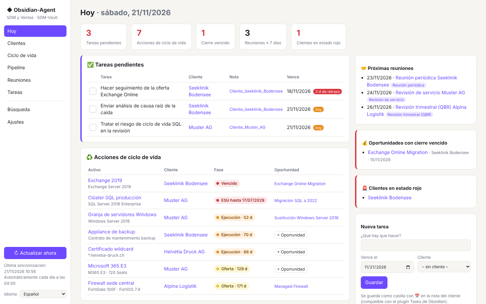
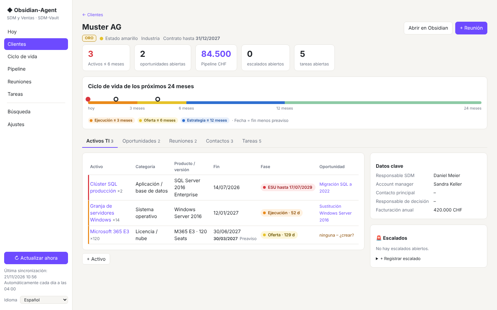
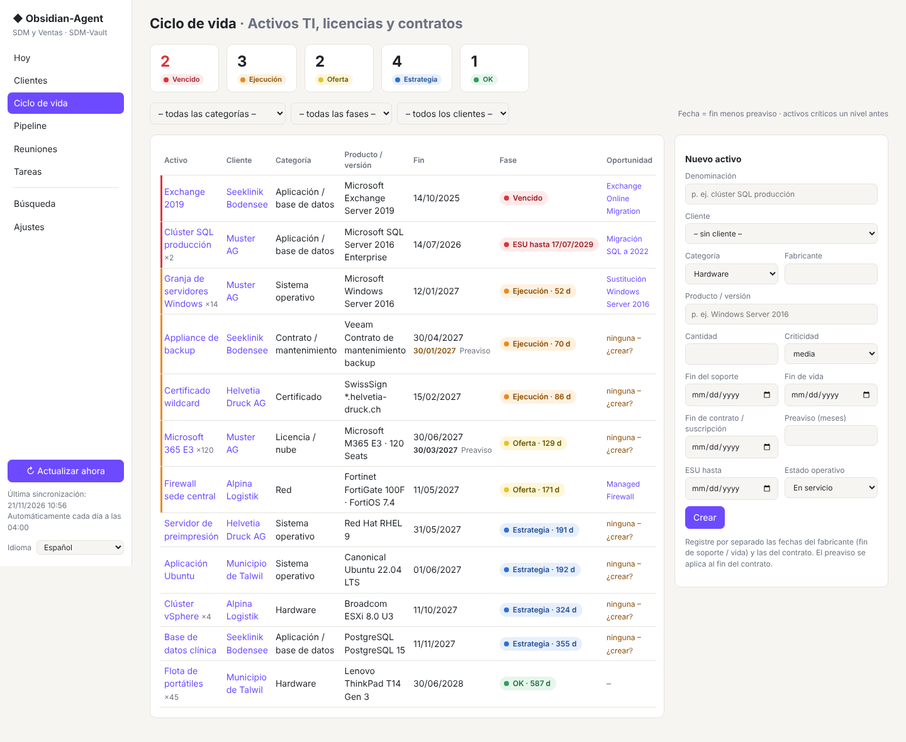
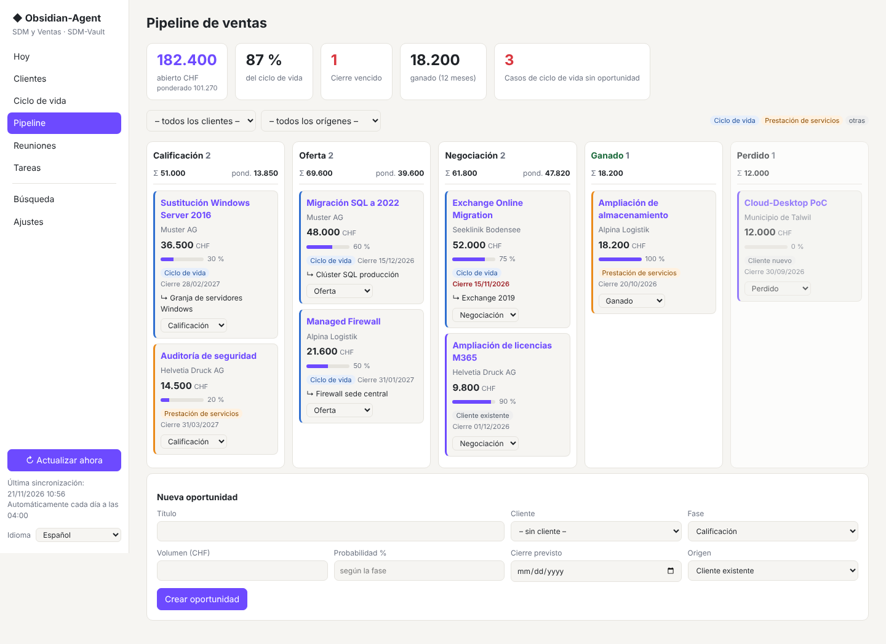
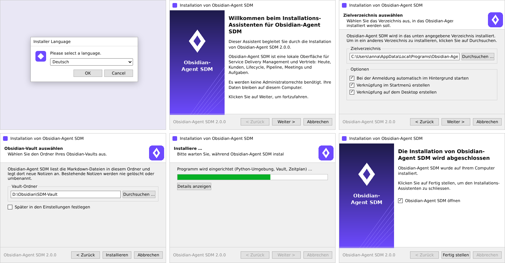

# ◆ Obsidian-Agent SDM

🇩🇪 [Deutsch](README.md) · 🇬🇧 [English](readme_en.md) · 🇪🇸 **Español**

### Convierte tu bóveda de Obsidian en el cockpit de la prestación de servicios y las ventas: clientes, ciclo de vida, pipeline, reuniones y tareas de un vistazo.

**Local. Sin nube. Sin dependencia. Todo sigue siendo Markdown.**

`Windows` `macOS` `Linux` `Python 3.10+` `6 idiomas` `http://127.0.0.1:5055`

**[⬇️ Descarga](#descarga) · [📚 Documentación](obsidian-agent-readme/docs/README.md) · [⚡ Instalación rápida](obsidian-agent-readme/docs/README.md#instalacion-rapida)**

---

## El problema

El SQL Server del cliente lleva meses sin soporte. La suscripción del firewall vence en primavera. El plazo de preaviso de las licencias de Microsoft 365 termina la semana que viene. Y la oferta que debería haber salido de todo esto todavía no existe.

La información está ahí, pero dispersa: en el sistema de tickets, en hojas de Excel, en notas de reuniones y en la cabeza del responsable de servicio.

> ¿Qué sistemas de mis clientes llegan al fin de su vida útil en los próximos doce meses?
> ¿Dónde estoy a punto de perder un plazo de preaviso?
> ¿Qué temas de ciclo de vida aún no tienen oportunidad?
> ¿Qué tengo que tratar mañana en la revisión de servicio?

Obsidian es ideal para guardar este conocimiento. Con consultas Dataview, plantillas y complementos se puede construir mucho. Pero cada vista hay que programarla y mantenerla uno mismo, y nadie calcula los plazos por ti.

## La solución

**Obsidian-Agent SDM** lee tu bóveda y la convierte en un espacio de trabajo para la gestión de servicios y las ventas. Calcula cuándo tienes que actuar y te muestra dónde la operación se convierte en negocio.

| | |
|---|---|
| 🎯 **Un cockpit para tu día.** Tareas pendientes, acciones de ciclo de vida, cierres vencidos y próximas reuniones en una sola página. | ♻️ **Ciclo de vida con método.** Las fases estrategia, oferta y ejecución se calculan automáticamente a partir del fin de soporte, el fin de vida y el preaviso. |
| 💰 **De la operación al upselling.** Cada activo que vence se convierte con un clic en una oportunidad vinculada. | 🏢 **Clientes de un vistazo.** SLA, estado, pipeline, contactos, escalados y una línea de tiempo de ciclo de vida de 24 meses. |
| 📝 **Markdown sigue siendo la fuente de verdad.** Cada cambio se guarda como una nota normal en la bóveda. Puedes seguir trabajando en Obsidian en cualquier momento. | 🌍 **Seis idiomas.** Alemán, inglés, francés, italiano, español y rumano, con cambio en un clic. |

---

## Funciones

### 🎯 Hoy
Tu punto de partida del día: tareas pendientes y vencidas, casos de ciclo de vida de los próximos seis meses (con aviso de dónde aún no hay oportunidad), oportunidades con cierre vencido, las reuniones de los próximos días y los clientes en estado rojo. Cada mañana el agente escribe además el mismo resumen en tu bóveda como `Hoy.md`.

### 🏢 Clientes y perfil del cliente
Todos los clientes como fichas con nivel de SLA, semáforo, fin de contrato, próximo caso de ciclo de vida y pipeline abierto. Un clic abre el perfil: indicadores, línea de tiempo de 24 meses y pestañas para activos de TI, oportunidades, reuniones, contactos y tareas. Los escalados se registran directamente en la barra lateral.

### ♻️ Ciclo de vida
Hardware, sistemas operativos, bases de datos, licencias, contratos y certificados en una lista ordenada por urgencia. Lo decisivo es la **fecha de acción**: la más temprana entre el fin de soporte o de vida y el fin del contrato menos el preaviso.

| Fase | Fecha de acción dentro de | Qué hacer ahora |
|---|---|---|
| 🔵 Estrategia | ≤ 12 meses | tratarlo en la revisión de servicio, iniciar el presupuesto |
| 🟡 Oferta | ≤ 6 meses | concepto con delivery, preparar la oferta |
| 🟠 Ejecución | ≤ 3 meses | pedir, respetar los plazos, planificar la migración |
| 🔴 Plazo vencido / Vencido | superada | aclarar de inmediato, se muestra el periodo ESU |

Los activos críticos para el negocio avanzan automáticamente una fase.

### 💰 Pipeline de ventas
Tablero kanban desde la calificación hasta el cierre, con volumen total y ponderado por fase. Ves qué parte del pipeline procede del ciclo de vida y cuántos casos aún no tienen oportunidad. Cambias la fase directamente en la tarjeta y el agente la guarda en la nota.

### 🤝 Reuniones
Reunión periódica, revisión de servicio, revisión trimestral, llamada o taller: cada acta nueva incluye automáticamente los temas de ciclo de vida de los próximos doce meses y todas las tareas abiertas del cliente. La preparación se hace en segundos.

### ✅ Tareas
Las tareas son líneas normales con casilla en tus notas, compatibles con el complemento **Tasks** de Obsidian: `- [ ] Enviar la oferta 📅 2026-12-01`. El agente las reúne de toda la bóveda, las agrupa por vencimiento y te deja marcarlas directamente.

### Y además
- 🔎 **Búsqueda de texto completo** en toda la bóveda
- 📄 **Plantillas de Obsidian** para cliente, contacto, activo, oportunidad, reunión y escalado, en cada idioma
- 🌙 **Modo oscuro** según la configuración del sistema
- 🔄 **Sincronización diaria** a las 04:00; las ejecuciones perdidas se recuperan
- 🧩 **Compatible con versiones anteriores**: se reconocen notas antiguas con `typ: lcm`, comentarios YAML o nombres de cliente en lugar de enlaces
- 👥 **Para equipos**: los nombres de las propiedades son iguales en todos los idiomas, así que equipos mixtos comparten una bóveda

---

## ¿Por qué no simplemente Dataview y compañía?

| | Obsidian + complementos | Obsidian-Agent SDM |
|---|:---:|:---:|
| Notas en Markdown, sin dependencia | ✅ | ✅ |
| Tablas y consultas sobre propiedades | ✅ | ✅ |
| Fases de ciclo de vida con preaviso calculadas automáticamente | – | ✅ |
| Oportunidad desde un activo con un clic | – | ✅ |
| Pipeline con volumen ponderado | – | ✅ |
| Acta de reunión rellenada con temas de ciclo de vida y tareas abiertas | – | ✅ |
| Interfaz lista para usar, sin escribir consultas | – | ✅ |
| Resumen diario en la bóveda, incluso con Obsidian cerrado | – | ✅ |
| Seis idiomas, plantillas incluidas | – | ✅ |

El agente no sustituye a Obsidian. Lo complementa: tú sigues escribiendo en Obsidian, el agente calcula y muestra.

---

## ⬇️ Listo en 5 minutos

| Descarga | Para |
|---|---|
| **[ObsidianAgent-SDM-Setup-Windows.zip](ObsidianAgent-SDM-Setup-Windows.zip)** | Windows 10/11 con asistente de instalación |
| **[ObsidianAgent-SDM-Mac.zip](ObsidianAgent-SDM-Mac.zip)** | macOS 11+ (paquete de instalación) |
| [ObsidianAgent-SDM.zip](ObsidianAgent-SDM.zip) | sin instalador, también Linux |

**Windows**
1. Instala [Python](https://www.python.org/downloads/windows/) y marca «Add python.exe to PATH».
2. Descomprime y ejecuta `ObsidianAgent-SDM-Setup.exe`.
3. En el asistente, elige el idioma, la carpeta de instalación con opciones (inicio automático, menú Inicio, escritorio) y tu bóveda de Obsidian. Listo.

**macOS**
1. Instala [Python](https://www.python.org/downloads/macos/) o ejecuta `brew install python`.
2. Descomprime y abre `ObsidianAgent-SDM.pkg` con clic derecho → Abrir.
3. Elige la bóveda en la ventana de Terminal. Listo.

**➜ Después ábrelo en el navegador: [http://127.0.0.1:5055](http://127.0.0.1:5055)**

Instalación rápida con todos los pasos: [documentación](obsidian-agent-readme/docs/README.md#instalacion-rapida) · guía completa: [Guia_es.md](obsidian-agent-readme/docs/Guia_es.md)

---

## Seguro y sin riesgo

- 🔒 **Tus datos se quedan contigo.** El agente solo funciona en tu ordenador; nada se envía a la nube.
- 📝 **Tu bóveda es tuya.** Todo es Markdown. La base de datos es solo un índice y se reconstruye en cada sincronización.
- 🧹 **Desinstalación limpia.** Se eliminan el inicio automático y la programación, y la configuración se guarda en el escritorio. La bóveda nunca se modifica.
- 🚚 **Traslado sencillo.** Reinstalar, copiar `config.json` y seguir trabajando.
- 👤 **Sin derechos de administrador.** La instalación se hace en tu cuenta de usuario.
- 🛡️ **Privacidad desde el diseño.** Los contactos tienen una fecha de borrado y las plantillas invitan a notas objetivas y profesionales.

---

## 📚 Documentación en seis idiomas

| Idioma | Guía |
|---|---|
| 🇩🇪 Deutsch (original) | [Anleitung_de.md](obsidian-agent-readme/docs/Anleitung_de.md) |
| 🇬🇧 English | [Guide_en.md](obsidian-agent-readme/docs/Guide_en.md) |
| 🇫🇷 Français | [Guide_fr.md](obsidian-agent-readme/docs/Guide_fr.md) |
| 🇮🇹 Italiano | [Guida_it.md](obsidian-agent-readme/docs/Guida_it.md) |
| 🇪🇸 Español | [Guia_es.md](obsidian-agent-readme/docs/Guia_es.md) |
| 🇷🇴 Română | [Ghid_ro.md](obsidian-agent-readme/docs/Ghid_ro.md) |

---

**Busca menos. No pierdas ningún plazo. Vende más.**

*Obsidian-Agent SDM: prestación de servicios y ventas en un solo cockpit.*

Todas las capturas muestran datos de ejemplo ficticios.
